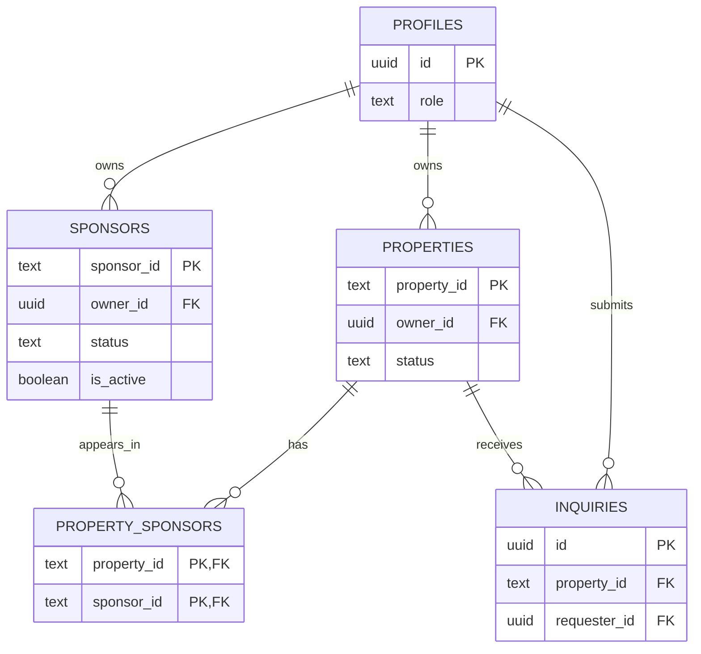

# Lab 5 entity relationships

Existing profiles are reused without modifying the midterm migration.

Junction parents cascade DELETE; property and profile references for inquiries
restrict deletion. Owner-profile deletion is restricted while owned rows exist.
Approval reviewer references use SET NULL; approved_at is required for approved
rows, but a non-null retained reviewer is not guaranteed after profile deletion.
Full moderation audit is outside this slice. Text/address/scalar CHECK constraints
and grants are in the versioned migration, not represented fully by this diagram.
